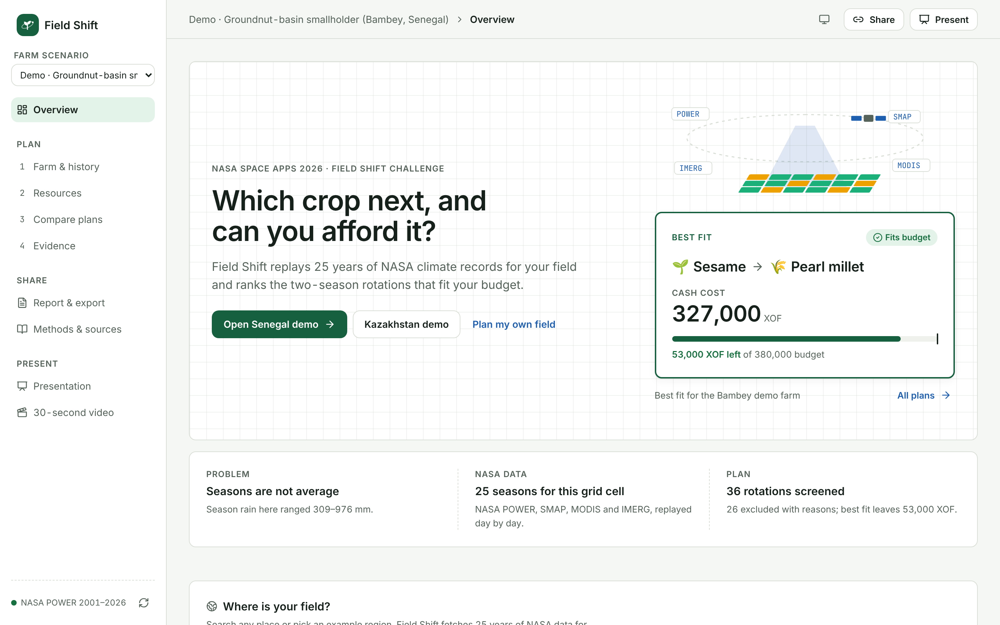
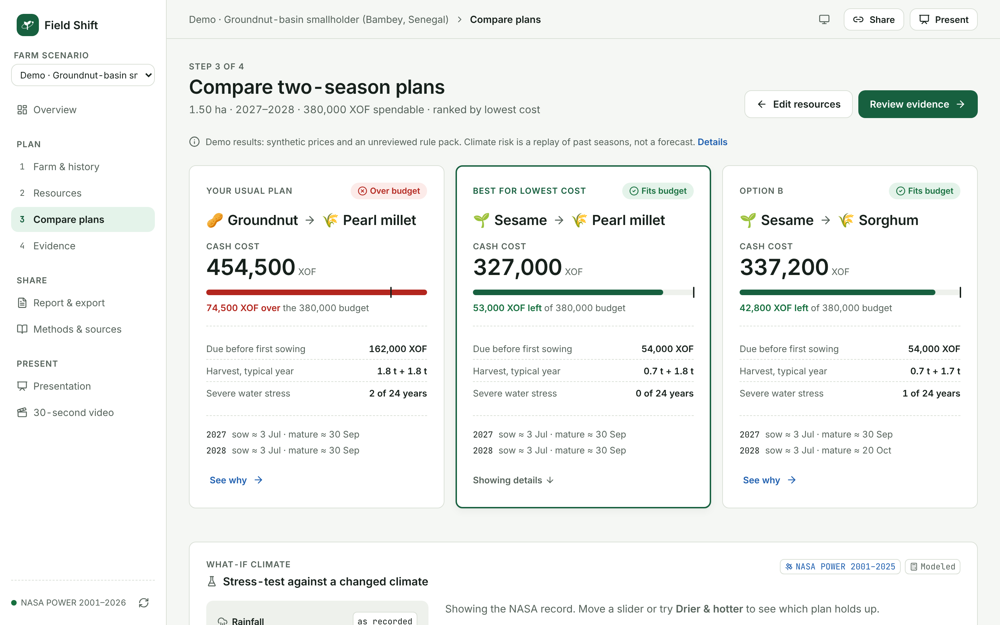

# 🛰️🌾 Field Shift — NASA-informed, budget-aware crop-rotation planner

## 🔗 Live app: **https://adrizh.github.io/AgroNASA/**

*Which next two-season rotations can I afford, and how do they hold up in a bad year? Replays 25 years of NASA POWER weather against your budget.*

**NASA Space Apps 2026 · Field Shift challenge (“Adapting farms with NASA data”)**

Every push to `main` runs the tests, builds, publishes to the `gh-pages` branch and verifies that the live URL serves the new build.




Field Shift helps a farmer (or the extension worker sitting with them) answer one question:

> *“Given what I grew and applied before, my resources now and the conditions experienced here, which next two-season plans can I realistically consider — and afford?”*

It fuses **25 years of NASA Earth observations** with **what the farmer knows** — crop and fertilizer history, soil, budget, labor, seed and market constraints — and compares the farmer’s usual plan with up to two feasible alternatives. Every number is traceable to an input, a formula or a sourced rule, and every option carries its cost, cash timing, modeled climate risk and reasons. **It informs rather than decides.**

---

## Works anywhere on Earth

Search a place, click the map, use GPS, or pick one of 15 example farming regions (each pin verified as cropland in MODIS land cover). Field Shift then:

1. downloads 25 years of daily **NASA POWER** data for that grid cell (live, ~2–40 s, then cached),
2. detects the **country** (OpenStreetMap reverse geocoding) → local **currency**, **FAOSTAT** producer prices and exchange rate,
3. selects the **regional farming system** — 16 regional packs plus global screening:

| Pack | Seasons | Example |
|---|---|---|
| West African Sahel & Sudan savanna | rainy season (rain onset) | Bambey 🇸🇳, Kano 🇳🇬 |
| East Africa bimodal | long rains + short rains, same year | Nakuru 🇰🇪 |
| Ethiopian highlands | Meher | Debre Zeit 🇪🇹 |
| Southern Africa | summer rains | Lilongwe 🇲🇼, Zambia, Zimbabwe |
| South Asia | Kharif + Rabi | Karnal 🇮🇳, Pakistan, Bangladesh |
| Southeast Asia | wet + dry season | Can Tho 🇻🇳 |
| East Asia (North China Plain) | summer crop + winter wheat | Shijiazhuang 🇨🇳 |
| Mediterranean & West Asia | winter (autumn rains) | Settat 🇲🇦, Türkiye, Iran |
| Central Asia irrigated | summer + autumn-sown | Fergana 🇺🇿 |
| N. Kazakhstan & S. Siberia steppe | spring–summer | Kostanay 🇰🇿 |
| Europe & Black Sea | spring + autumn-sown | Kropyvnytskyi 🇺🇦 |
| North America | spring + autumn-sown | Iowa 🇺🇸, Canada |
| US Corn Belt | corn–soybean rotation | Iowa 🇺🇸 |
| South America | summer crop + safrinha | Sorriso 🇧🇷, Argentina |
| Brazil Cerrado | soy + safrinha | Sorriso 🇧🇷 |
| Australia | winter grain (autumn break) | Northam 🇦🇺 |
| Global screening | auto from NASA climatology | anywhere else |

## What’s inside

| Screen | What it does |
|---|---|
| **Overview** | Story, live summary of the current scenario, NASA seasonal-variability chart, data-source map. |
| **1 · Farm & history** | Map pin (search, GPS or click), area & units, auto-detected regional pack, last 1–3 crops with dates/outcomes, detailed fertilizer & manure records (normalized; unknowns stay unknown), farmer soil texture + SoilGrids profile. |
| **2 · Resources** | Funds, reserve, dated confirmed inflows, irrigation (with seasonal water cap), labor, unavailable seed, sellable crops, residue need, fallow option, one priority, baseline override, full **editable price & yield pack**. |
| **3 · Compare plans** | Usual plan + ≤2 ranked feasible alternatives (the usual plan is always shown, flagged): cash cost, headroom, upfront need, season split, modeled harvest range, modeled net, severe-stress risk, reason codes with source chips; cost-by-category chart vs budget; water-limited yield screening for every crop; “See why” with cost lines, cash timeline and 25-season replay; every excluded rotation with its blocking reason. **What-if climate stress test** (rain −30…+20 %, +0…+3 °C as a delta change on the 2001–2025 NASA POWER record; “Drier & hotter” = −15 % rain, +2 °C) re-runs the 24-season-pair replay live in ~30–50 ms. **Share** button: the scenario is encoded in the URL hash (validated, size-limited). New farms get a clearly labeled placeholder budget (spendable ≈ 90 % of the usual plan’s cash cost). |
| **4 · Evidence** | NASA climate record (monthly climatology, ET₀, season totals, dry runs, heat days, provenance), **this season so far** vs history + onset + NASA soil wetness, **16-day forecast** & planting-readiness, **NASA satellite layers** (MODIS NDVI, SMAP L4 soil moisture, GPM IMERG, MODIS LST, true colour, with date & −1-year compare), **past-season review** (descriptive, never causal), fertilizer nutrient timeline, and a **hindcast vs real FAOSTAT national yields**. |
| **Report** | Printable / PDF plan summary with sources; export, import and delete-all-data controls. |
| **Methods** | Pipeline, formulas, reason codes, rule packs (with review status), crop parameters, full evidence register, privacy & AI disclosure. |
| **Presentation** | Animated 12-slide explainer deck (problem, cash gap, users, solution, data fusion, sowing science, soil-water bucket, decision funnel, live result, hindcast, impact) with a **7-slide submission cut** and one-click PDF export. Live data from the selected farm. |
| **Design system** | [`docs/DESIGN.md`](docs/DESIGN.md): tokens and components, light and dark mode. |
| **30-second video** | Narrated 1080p MP4 (`public/media/field-shift-30s.mp4`) with original synthesized soundtrack and burned-in captions, plus a live animated version. See [`docs/PITCH.md`](docs/PITCH.md). |

### Data — NASA and non-NASA

| Source | Type | Used for |
|---|---|---|
| **NASA POWER daily** (MERRA-2, CERES/SYN1deg): `PRECTOTCORR, T2M, T2M_MAX, T2M_MIN, RH2M, WS2M, ALLSKY_SFC_SW_DWN` | NASA | Rain, heat, dry spells, FAO-56 ET₀, rain-onset / soil-warming sowing dates, water-balance replay, season-so-far |
| **NASA POWER `GWETROOT`, `GWETTOP`** | NASA | Root-zone / surface soil wetness vs normal |
| **NASA GIBS** map layers: MODIS NDVI, SMAP L4, GPM IMERG, MODIS LST, true colour | NASA | Satellite context around the field |
| **NASA values at the field pixel** (decoded from GIBS tiles + colormaps): MODIS Terra NDVI 16-day 2000→now, MODIS IGBP land cover, SMAP L4 root-zone soil moisture, GRACE/GRACE-FO water storage | NASA | Field greenness history, model-vs-satellite check (r), cropland check, soil moisture vs normal, groundwater trend, past-season review |
| **NASA EONET** natural events | NASA | Wildfires, floods, storms, drought, dust within ~300 km |
| **FAOSTAT** (FAO): producer prices, exchange rates, cropland nutrient budget, temperature change — from the team's Drive data index | non-NASA | Real crop prices (a price more than 3× off the global median is replaced by the median, labeled) & local currency for 240 countries; national N-budget and warming context |
| Farmer records (history, fertilizer, budget, constraints, prices) | non-NASA | Everything farm-specific — stored only in the browser |
| **ISRIC SoilGrids 2.0** (texture, SOC, pH, N, CEC, 0–60 cm) | non-NASA | Available water capacity via Saxton & Rawls (2006); pH warnings |
| Regional rule packs (16 regional packs plus global screening) | non-NASA | Crop calendars, return intervals, disease groups, legume/fallow benefits — each rule with source IDs and review status |
| **Open-Meteo** 16-day forecast | non-NASA | Short-term rain/temperature/ET₀, planting readiness |
| OpenStreetMap tiles & Nominatim | non-NASA | Base map, place search |

### Science (deterministic — no LLM in the decision path)

* **ET₀**: FAO-56 Penman–Monteith (Hargreaves fallback).
* **Sowing date per year**: Sahel/tropics — Sivakumar (1988) agronomic onset (3-day rain ≥ 20 mm, no > 7-day dry spell in the next 30 days). Temperate — 5-day mean T2M ≥ crop threshold, not before the climatological last spring frost + 7 days for frost-sensitive crops.
* **Water balance**: FAO-56 single-Kc daily root-zone depletion, growing roots, Ks stress, off-season soil water carried from the previous harvest with degree-day snowmelt (Hock 2003), FAO-56 deep storage (longer spin-up after fallow → moisture conservation), runoff assumption, optional irrigation to a declared cap.
* **Yield response**: FAO-66 Ky with FAO-33 stage-wise Ky, `1 − Ya/Ym = Ky (1 − ΣETa/ΣETc)`; a year with no sowing onset counts as a failed season; two-season plans replay **coherent consecutive year pairs** (Y, Y+1).
* **Budget**: integer minor-unit arithmetic; spendable = funds − reserve; cumulative cash checked at every due date with confirmed inflows only; never assumes harvest income or credit; missing essential price → “budget not verified”.
* **Rotation rules**: monocultures are excluded (`MONOCULTURE`, G-R6), the same family gets a warning (`SAME_FAMILY`), break crops get a bonus (`BREAK_CROP`).
* **Hindcast** (Evidence page): modeled water-limited yield vs detrended FAOSTAT national yields (bulk download, retrieved 2026-11-15). Kazakhstan wheat r = 0.59 (n = 24); Senegal millet r = 0.18 and groundnut r = 0.20 (n = 24). Weak by design of the comparison: one grid cell against a whole country. All four known drought years (Senegal 2002, 2011; Kazakhstan 2010, 2012) fall in the model’s driest third.
* **Replay data**: only NASA POWER is replayed through the water balance. MODIS, SMAP, IMERG, GRACE and EONET are context layers shown next to the result, not inputs to the replay.
* **Ranking**: eligible & affordable plans only, by the chosen priority with a documented deterministic tie-break; baseline always shown; 0–2 alternatives, never invented.

---

## Run it

Requires Node 18+ (tested on Node 22).

```bash
npm install
```

```bash
npm run dev
```

Open the printed URL (default http://localhost:5173). Offline-safe: every network call has a timeout, SoilGrids falls back to typical texture values, the two demo farms work fully offline from bundled NASA snapshots, and any other location is cached after its first download (≈ 10–40 s). The code-split landing page loads in about 395 kB gzip.

```bash
npm test
```

```bash
npm run build
```

`npm run build` produces a static site in `dist/` that can be hosted anywhere (relative paths).

### Deploy (GitHub Pages)

`.github/workflows/deploy.yml` tests, builds, publishes to the `gh-pages` branch and verifies the live URL on every push to `main`. The judging link must open without login — check it in a private window.

---

## Presentation & video

* **Presentation**: sidebar → *Presentation* (or `#/pitch`). Arrow keys / space to advance, `f` for full screen, Esc to exit. Toggle *Full story · 12* or *Submission cut · 7*; **PDF** prints one slide per page.
* **Video**: sidebar → *30-second video* (or `#/video`), or open `public/media/field-shift-30s.mp4` directly (1920×1080, 30 fps, 30.0 s, AAC at −14 LUFS).
  * Narration: Kokoro-82M neural TTS (voice `af_heart`, Apache-2.0), script in `src/ui/video/timing.json`.
  * Music & sound design: synthesized from scratch by `scripts/make-soundtrack.py` (no samples), ducked under the voice.
  * Visuals: deterministic React/SVG scenes (`src/ui/video/Scenes.tsx`) using real NASA POWER values and real engine output for the Senegal demo; rendered frame-by-frame.
  * Re-render: `npm run build && npm run preview`, then `npm run video:frames`, `npm run video:audio` (after `scripts/make-voiceover.py`), `npm run video:encode`. Requires Playwright, ffmpeg and Python (numpy, scipy, soundfile).

## Verification

`npm test` runs 135 tests across 8 files: the acceptance tests from the planning pack plus world-coverage, what-if, share-link, rotation-rule and security tests (FAOSTAT lookups, currency conversion, two-season scheduling, GIBS colormap decoding). The acceptance tests include:

* 100 kg / 2 ha = 50 kg/ha; 46 % N label → 23 kg applied N/ha; unknown manure composition stays unknown; unknown treated area never becomes the whole field.
* Budget boundary: funds 1,000 − reserve 100 → 900 passes, 900.01 fails; synthetic fixture baseline 1,120 excluded, A/B/C headroom 40/120/210; cash-timing violation detected; missing price → not verified.
* **NASA regression** on the archived D1 query: 9,131 records; Jun–Oct 2002 = 308.92 mm, 2009 = 975.63 mm; ≥10-day dry spells 20/25 (Jun–Oct) vs 1/25 (Jul–Sep); −999 fill values flagged, never zero.
* FAO-56 Example 18 ET₀ ≈ 3.9 mm/day.
* Engine: baseline always shown; no “affordable” plan violates cash timing; rule exclusions carry IDs; unavailable seed removed with reason; honest zero-result state; deterministic output; no causal language in past-season reviews.

### Refreshing FAOSTAT data

`scripts/build-faostat.py` turns the FAOSTAT bulk downloads (PP, PE, ESB, ET — the same files listed in the team's Drive data index) into `src/data/faostat/countries.json`. Requires Python with `pycountry`.

## Project structure

```
src/
  domain/      types, units & fertilizer normalization, dates
  weather/     NASA POWER adapter & cache, indicators, FAO-56 ET₀, water balance, forecast/geocoder
  soil/        SoilGrids adapter, texture, Saxton–Rawls AWC
  engine/      replay (sowing + climate risk), budget, plan (rules, ranking, reasons), past-season review
  data/        crop library, regional rule & price packs, fertilizer library, evidence register, bundled demo data
  state/       app context, local persistence (localStorage + IndexedDB), demo scenarios
  ui/          pages (Overview, Farm, Resources, Compare, Evidence, Report, Methods, Pitch) & components
tests/         acceptance tests
data/archive/  raw NASA POWER / SoilGrids responses used for regression
docs/          pitch kit, review log
```

## Honest limits

* **Not validated agronomic advice.** Rule packs are `demo-unreviewed` until a local agronomist signs [`docs/review-log.md`](docs/review-log.md). No user tests have been completed.
* **Default prices, yields and demo farms are synthetic.** Replace them with dated local quotes in *Resources*.
* NASA POWER is a ~50 km grid estimate, not the field. Modeled yields are conditional historical scenarios, not forecasts. Rainfall totals are not plant-available water.
* No fertilizer dosing, no soil-nutrient inference from purchases, no causal diagnosis of past failures, no profit guarantees.
* Input-cost templates are synthetic for every region; crop prices are national FAOSTAT averages, not farm-gate quotes.
* GIBS-decoded values are quantized by the colormap and sit on 300 m–25 km pixels; land cover may misclassify small fields.
* The team's `All_data_with_climate` trial dataset (cereal–legume field trials with NASA POWER weather) is not yet used: it was too large to transfer through the Drive connector. It is the obvious next step for validating yields.

## Privacy

Crop history, fertilizer, prices and budget stay in the browser. NASA POWER, SoilGrids, Open-Meteo and the map/geocoder receive only coordinates or a place name. Export, import and delete-all are on the Report page.

## Security

No secrets, no backend and no third-party scripts: a strict Content-Security-Policy (`script-src 'self'` plus build-time hashes) allows only the NASA, ISRIC, Open-Meteo, OpenStreetMap and Google Fonts hosts the app uses.
Share links, imported files, device storage and API responses are size-limited, schema-checked and clamped (`tests/security.test.ts`). `npm audit` reports 0 vulnerabilities, and the deploy workflow uses least-privilege permissions and SHA-pinned actions.
Details, CSP rationale and residual risks: [docs/SECURITY.md](docs/SECURITY.md).

## Credits & disclosure

Weather and soil-wetness data: NASA POWER Project (NASA Langley Research Center). Satellite imagery: NASA EOSDIS GIBS / Worldview. Soil: ISRIC SoilGrids. Forecast: Open-Meteo. Maps © OpenStreetMap contributors. **NASA does not endorse this project.**
Planning pack (specification, research, implementation plan) prepared by the team; AI assistance was used for research synthesis, documents and code, as disclosed per the Space Apps submission guide.
